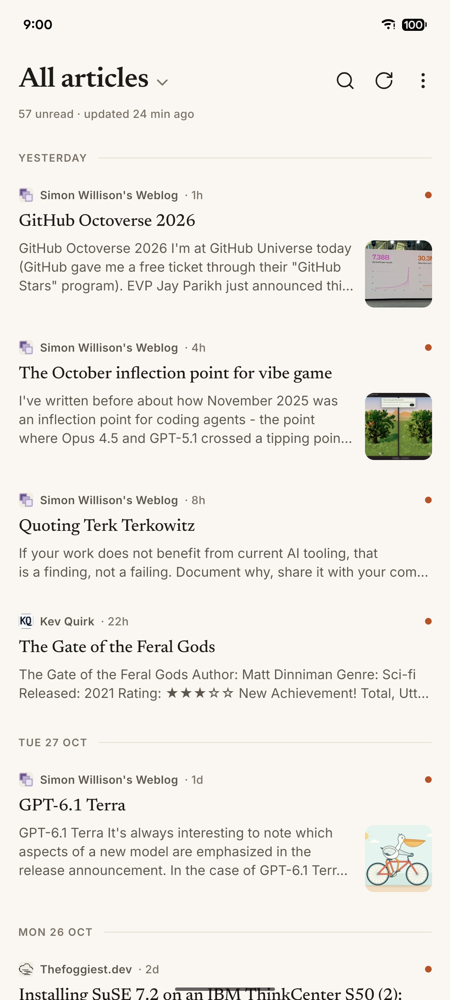
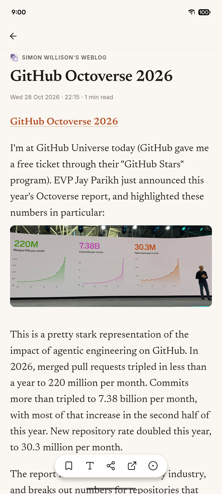
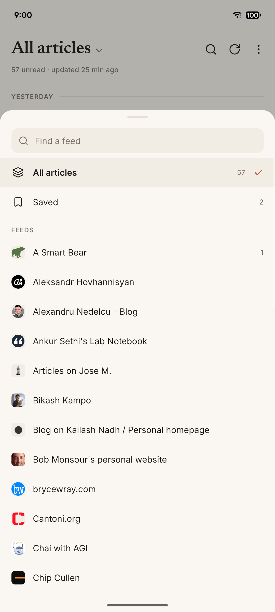
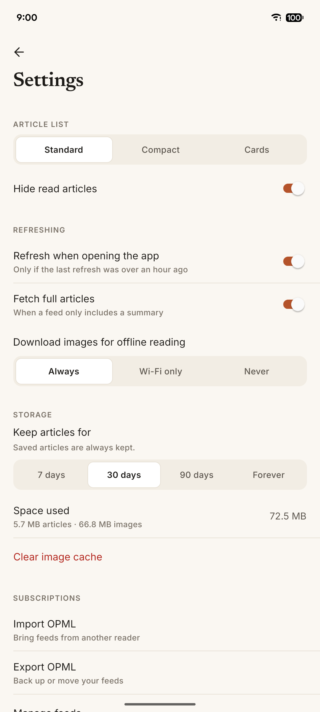

# Feedline

A calm, offline-first RSS reader for Android. No accounts, no servers, no tracking: feeds, articles and images all live on your phone.

<p>
  
  
  
  
</p>

## Install

[](https://github.com/deepakness/feedline/releases/latest/download/feedline.apk)

1. On your phone, tap **Download APK** above. It always fetches the latest version.
2. Open the downloaded `feedline.apk`. If Android asks, allow your browser to install apps.
3. Open Feedline and add a feed, or import an OPML file from another reader.

It needs Android 7.0 or newer. `feedline.apk` is for 64-bit phones, which is almost every phone from the last several years. For an older or budget phone with a 32-bit processor, download [`feedline-armv7.apk`](https://github.com/deepakness/feedline/releases/latest/download/feedline-armv7.apk) instead. If you're not sure, try `feedline.apk` first; a phone that can't use it says the app isn't compatible.

**Warnings during install are normal.** Your browser or Google Play Protect may warn about an app from outside the Play Store. Choose to keep the download, and if Play Protect blocks it, tap **More details → Install anyway**. Feedline has no ads, trackers or accounts; the [source](src) is all here.

**Updating:** in Feedline, open **Settings → Follow Feedline updates**. New versions then show up in your timeline like any other article. Download the new APK the same way and install it over the old one; your feeds, saved articles and settings are kept. Changes are listed in [CHANGELOG.md](CHANGELOG.md) and on the [releases page](https://github.com/deepakness/feedline/releases).

<details>
<summary>Verify the APK (optional)</summary>

Every release is signed with the same key. Check it with `apksigner verify --print-certs feedline.apk` or [AppVerifier](https://github.com/soupslurpr/AppVerifier):

```
com.deepak.feedline
53:B4:1E:C6:77:80:F0:35:78:59:BA:C1:58:72:BE:9F:CD:E9:89:C1:0F:F6:AC:21:75:82:BA:CF:63:02:2E:1D
```

Each APK has a matching `.sha256` file in the release. Check it with `shasum -a 256 -c feedline.apk.sha256`.
</details>

## Features

- Full article text and images saved on refresh for offline reading
- Unified timeline grouped by day; Standard, Compact and Cards layouts
- Reader with adjustable size, spacing and serif or sans type
- Saved articles, full-text search, hide read, mark all read
- Add feeds by site address or from the share sheet; OPML import and export
- Manual refresh, or automatically on open; configurable article retention

## Privacy

Feedline has no analytics, ads or accounts. The only network requests it makes are to the feeds and article pages you subscribe to.

## Build

```bash
npm install
npm run build:apk   # dist/release/: APKs and checksums (JDK 17, Android SDK and your own signing key)
```

`scripts/build-apk.sh` pins the release certificate. Change `EXPECTED_CERT_SHA256` to your key's fingerprint before building your own. See `AGENTS.md` for development notes.

Feedline was built with AI assistance (Claude Code).

## License

[MIT](LICENSE). Bundled fonts and Readability are covered in [NOTICE.md](NOTICE.md).
